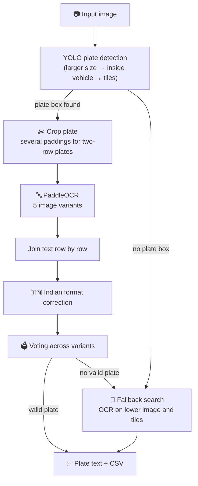

# 🚗 ANPR — Automatic Number Plate Recognition (Indian Plates)

An Automatic Number Plate Recognition (ANPR) system built using **Python, YOLO, PaddleOCR and OpenCV**. The project detects vehicle number plates from images, extracts their text, and applies rule-based correction to recognize Indian vehicle registration formats.

The system also supports two-row number plates, multiple plates in a single image, OCR voting, and performance evaluation against manually prepared ground-truth data.

---

## 📊 Results

Evaluated on a dataset containing **47 ground-truth number plates** collected from real-world vehicle images.

| Evaluation Metric | Result |
|---|---:|
| Plate detection rate | **100%** |
| Exact-match OCR accuracy (all 47 plates) | **80.85%** |
| Exact-match OCR accuracy (39 Indian-format plates) | **82.05%** |
| Average character similarity | **95.60%** |

### Accuracy improvement during development

| Pipeline development stage | Approximate exact OCR accuracy |
|---|---:|
| Initial pipeline | 22–33% |
| Color/CLAHE input, row-wise text joining and format correction | ~57% |
| Stricter format rules, two-row handling and detection cascade | ~72% |
| Additional image variants, voting and stronger fallback | **~81%** |

**Evaluation note:** The same image collection was used during development and parameter tuning. Therefore, these results should not be interpreted as independent test-set performance. Eight of the 47 ground-truth plates were non-standard, foreign, custom or name plates.

---

## ✨ Features

- **YOLO-based plate detection:** Uses a custom-trained YOLO model to locate vehicle number plates.
- **Multi-stage detection cascade:** Includes standard detection, higher-resolution detection, vehicle-region detection and overlapping image-tile detection.
- **Two-row plate recognition:** Uses additional vertical crop padding and optional separate-row OCR recognition.
- **Multiple plate detection:** Supports multiple number plates in a single image.
- **Multiple OCR variants:** Processes plate crops using color, CLAHE, sharpened, enlarged and smaller CLAHE-enhanced images.
- **OCR voting:** Combines recognition candidates to reduce errors caused by individual character confusion.
- **Indian number plate correction:** Applies rule-based character correction for standard Indian registration formats, older short formats and Bharat series plates.
- **Watermark filtering:** Filters common stock-image watermark text.
- **Fallback recognition:** Searches additional image regions when the plate detector does not find a valid candidate.
- **Performance evaluation:** Calculates detection rate, exact-match accuracy and average character similarity.
- **CSV output:** Saves recognized plate information and evaluation results.

---

## ⚙️ How It Works



### Processing stages

1. **Plate Detection:** The custom YOLO model detects number plates. If the initial detection does not find a suitable candidate, the system attempts higher-resolution detection, vehicle-region detection and overlapping image tiles.

2. **Plate Cropping:** Detected regions are cropped with different horizontal and vertical padding values. Additional vertical padding helps include both rows of two-line number plates.

3. **Image Enhancement:** Multiple image variants are generated, including color, CLAHE, sharpened, enlarged and smaller CLAHE-enhanced versions.

4. **Text Recognition:** PaddleOCR extracts text and its position from the enhanced plate images. Text boxes are grouped by vertical position and read from left to right within each row.

5. **Format Correction:** A rule-based correction algorithm evaluates candidate text against Indian registration number formats. Non-standard plate text is retained when it cannot be reliably fitted to an Indian format.

6. **Candidate Voting:** Recognition candidates from different image variants are compared, with valid Indian-format readings receiving priority.

7. **Fallback Recognition:** If the normal detection process does not produce a valid plate result, additional image regions are searched using OCR.

8. **Result Generation:** Recognized plate numbers, confidence values, format validity, detection source, date and time are saved in a CSV file.

---

## 📁 Project Structure

```text
Automatic_Number_Plate_Recognition/
│
├── ANPR_Model.ipynb
├── README.md
├── requirements.txt
├── .gitignore
├── LICENSE
│
├── images/                  # Input vehicle images (not included)
│
├── weights/
│   └── best.pt              # Custom-trained YOLO weights (not included)
│
├── ground_truth.csv         # Manual evaluation labels (not included)
│
├── output/                  # Generated plate crops and annotated images
│
└── database/
    └── plate_results.csv    # Generated recognition results
```

---

## 💻 Installation

### 1. Clone the repository

```bash
git clone https://github.com/prachikale05/Automatic_Number_Plate_Recognition.git

cd Automatic_Number_Plate_Recognition
```

### 2. Create a virtual environment

**Windows:**

```bash
python -m venv venv
venv\Scripts\activate
```

**Ubuntu / Linux / macOS:**

```bash
python3 -m venv venv
source venv/bin/activate
```

### 3. Install dependencies

```bash
pip install -r requirements.txt
```

**Important:** This project uses the PaddleOCR 2.x API. The requirements therefore restrict PaddleOCR to versions below 3. A compatible PaddlePaddle installation is also required.

### 4. Download the required model files

Place your custom-trained YOLO plate-detection weights at:

```text
weights/best.pt
```

The vehicle detection model `yolov8n.pt` is downloaded automatically by Ultralytics when required.

### 5. Launch Jupyter Notebook

```bash
jupyter notebook
```

Open `ANPR_Model.ipynb`.

---

## 🚀 Usage

1. Place your vehicle images inside the `images/` directory.
2. Place your custom YOLO weights at `weights/best.pt`.
3. For evaluation, create a `ground_truth.csv` file containing the actual plate numbers.

### Ground-truth CSV format

```csv
Image Name,Actual Plate
car1,MH02AR6675
car2,KL11BD3333
car3,WB12BE2605
```

If an image contains multiple number plates, add a separate row for each plate using the same image filename.

4. Check the input paths in the first notebook cell:

```python
IMAGES_FOLDER = "images"
PLATE_WEIGHTS = "weights/best.pt"
GROUND_TRUTH_CSV = "ground_truth.csv"
```

5. Run the notebook cells in order, or select **Kernel → Restart & Run All**.
6. The system processes the images and generates recognition results.

### Generated outputs

| Output | Description |
|---|---|
| `database/plate_results.csv` | Recognized plate numbers and associated details |
| `output/` | Annotated vehicle images and extracted plate crops |
| Evaluation report | Detection rate, exact-match accuracy and character similarity |

---

## ⚠️ Known Limitations

- OCR may confuse visually similar characters, such as `B/8`, `O/0`, `S/5` and `I/1`.
- Non-Indian, custom and decorative number plates cannot always be corrected using Indian registration format rules.
- Small, blurry, angled or partially hidden plates may be missed or incorrectly recognized.
- Processing can be slower on CPU because multiple detection and OCR attempts may be performed.
- Evaluation is based on a relatively small collection of 47 ground-truth plates.
- Accuracy on completely unseen images may differ from the reported results.

---

## 🔒 Data and Privacy

The vehicle images used during development were collected from publicly accessible websites and online sources for educational and experimental purposes.

These images, their ground-truth labels and generated recognition results are not included in this repository. Image copyright remains with the respective owners.

Users should only process images they have permission to use. Vehicle registration numbers may contain personally identifiable information and should be handled responsibly.

The custom-trained model weights are also not included in the repository. Users must provide their own authorized copy of `best.pt`.

---

## 🔮 Future Work

- Improve recognition of two-row, low-light and angled number plates.
- Fine-tune the OCR recognition model using a dedicated number plate dataset.
- Evaluate the system on a separate, unseen test dataset.
- Implement video-based number plate recognition.
- Introduce vehicle tracking and temporal OCR voting across video frames.
- Develop a simple web or desktop interface for real-time recognition.

---

## 🛠️ Tech Stack

- **Programming Language:** Python
- **Development Environment:** Jupyter Notebook
- **Object Detection:** Ultralytics YOLO
- **OCR:** PaddleOCR
- **Image Processing:** OpenCV
- **Numerical Processing:** NumPy
- **Data Processing:** Pandas
- **Visualization:** Matplotlib

---

## 👩‍💻 Author

**Prachi Kale**

B.Tech – Robotics & Automation

[GitHub](https://github.com/prachikale05)

